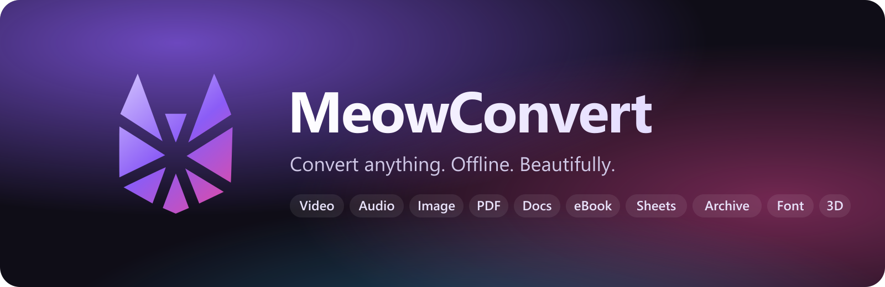
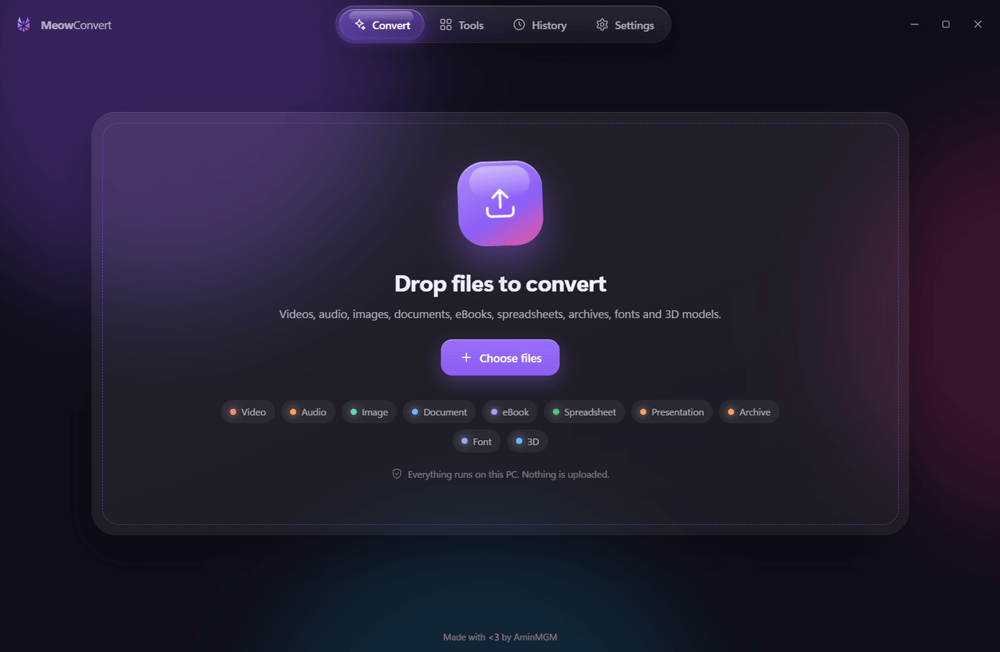
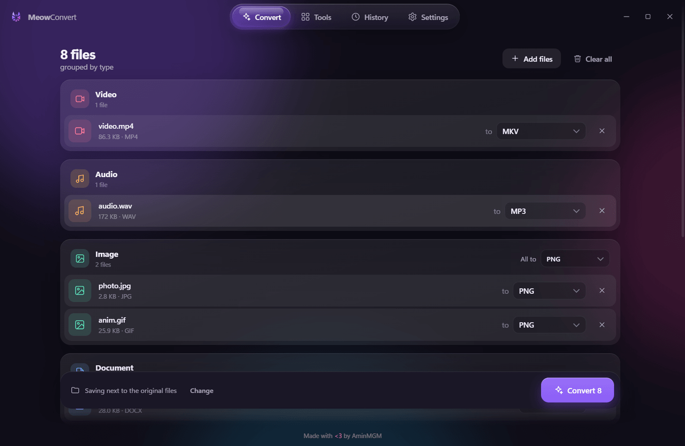
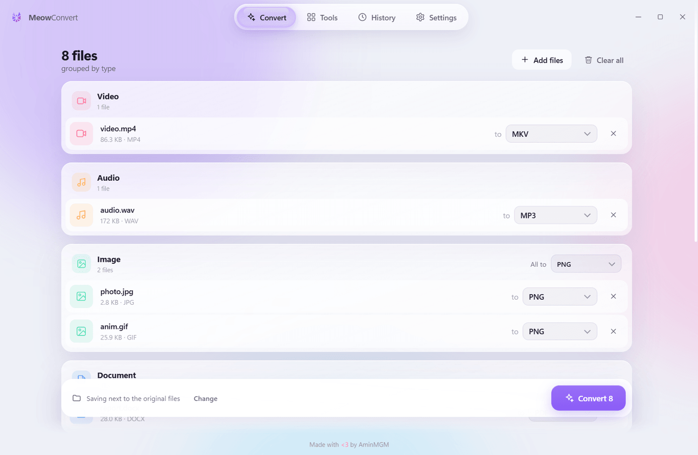
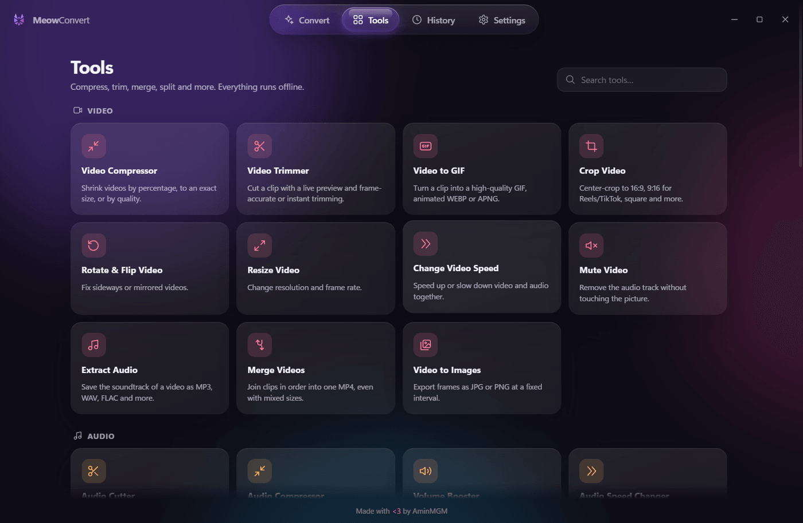
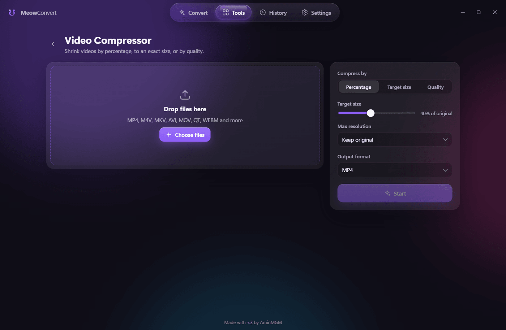
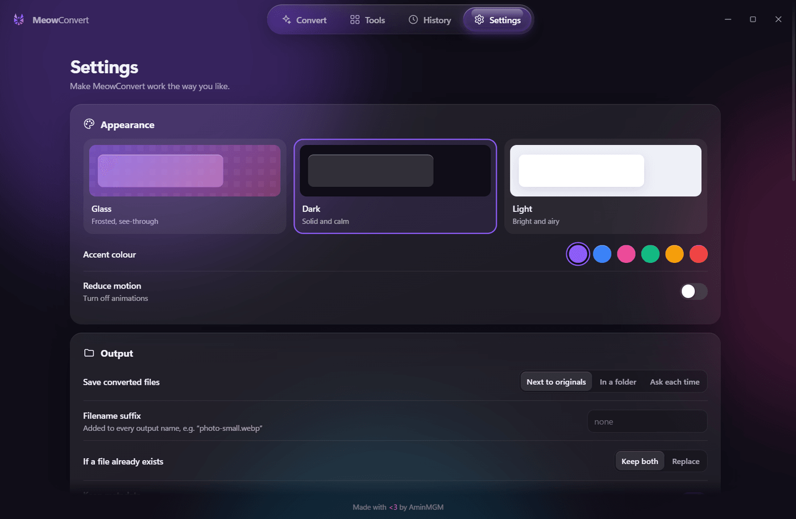

<div align="center">



<br />

[](https://github.com/AminMGM/MeowConvert/releases/latest)
&nbsp;

&nbsp;

&nbsp;
[](#license)

**A private, offline file converter for Windows.**<br />
Drop any file, pick a format, done. Nothing is ever uploaded.

[**Download for Windows**](https://github.com/AminMGM/MeowConvert/releases/latest) · [Features](#-features) · [Formats](#-formats) · [Tools](#-tools) · [Build from source](#-build-from-source)

</div>

<br />

<p align="center">
  
</p>

## ✨ Features

<table>
<tr>
<td width="50%" valign="top">

### 🔒 Private by design
Every conversion runs on your PC with bundled engines: FFmpeg, libvips, 7-Zip, pdf.js and more. No accounts, no uploads, no file-size limits.

### 🪄 Drop and go
The whole window is a drop target. Drop files or entire folders, and MeowConvert groups them by type and picks a sensible output format for each one.

### ⚡ Fast
Converts several files in parallel, encodes video on the GPU (NVIDIA NVENC, Intel Quick Sync, AMD AMF) with an automatic CPU fallback, and downloads only the changed parts of the app when updating.

</td>
<td width="50%" valign="top">

### 🧊 Liquid-glass design
A floating glass navigation bar, Windows 11 acrylic and mica backdrops, native rounded corners, and **Glass**, **Dark** and **Light** themes with six accent colours.

### 🧰 34 built-in tools
Compress, trim, crop, merge, split, watermark, vectorise, make GIFs, ringtones and favicons, and more. See [Tools](#-tools).

### 🔄 Always up to date
Checks GitHub releases automatically and installs updates when you close the app.

</td>
</tr>
</table>

<p align="center">
  
  
</p>

## 📁 Formats

| | Reads | Writes |
|---|---|---|
| 🎬 **Video** | MP4, MKV, AVI, MOV, WEBM, FLV, WMV, MPEG, TS/MTS/M2TS, VOB, 3GP, OGV, MXF, DIVX, RM… | MP4, MKV, WEBM, MOV, AVI, WMV, FLV, M4V, MPG, 3GP, 3G2, OGV, TS, MTS, M2TS, VOB, ASF, DIVX, F4V, MXF, SWF · GIF, animated WEBP, APNG · JPG/PNG frames · any audio format |
| 🎵 **Audio** | MP3, WAV, AAC, FLAC, OGG, OPUS, M4A, WMA, AIFF, AC3, AMR, DTS, APE, tracker modules… | MP3, WAV, AAC, M4A, FLAC, ALAC, OGG, OPUS, WMA, AIFF, M4R, M4B, AC3, E-AC3, DTS, AMR, AWB, MP2, AU, CAF, WV, TTA, MKA, VOC, SPX |
| 🖼️ **Image** | JPG, PNG, WEBP, AVIF, GIF, TIFF, SVG, HEIC, BMP, ICO, TGA, PSD, DDS, EXR, HDR, QOI, JP2… | JPG, PNG, WEBP, AVIF, GIF, TIFF, BMP, ICO, PDF, SVG (traced), TGA, JP2, PPM, PCX, QOI, SGI, XBM, HDR, EXR… |
| 📄 **Document** | PDF, DOCX, HTML, Markdown, TXT, RTF | PDF, DOCX, HTML, TXT, Markdown, EPUB · PDF pages to JPG/PNG/WEBP |
| 📚 **eBook** | EPUB | PDF, DOCX, HTML, TXT, Markdown |
| 📊 **Spreadsheet** | XLSX, XLS, XLSB, ODS, CSV, TSV, Numbers, JSON | XLSX, XLS, XLSB, ODS, CSV, TSV, JSON, XML, HTML, Markdown, PDF |
| 🗜️ **Archive** | ZIP, 7Z, RAR, TAR, GZ, BZ2, XZ, ZST, ISO, CAB, LZH… | ZIP, 7Z, TAR, TAR.GZ, TAR.BZ2, TAR.XZ, TAR.ZST |
| 🔤 **Font** | TTF, OTF, WOFF, WOFF2, EOT | TTF, WOFF, WOFF2, EOT, SVG font |
| 🧊 **3D** | OBJ (+MTL), STL, PLY, GLB, GLTF, FBX, DAE, 3DS, 3MF, AMF, VTK, PCD, WRL, USDZ, LWO | GLB, GLTF, OBJ, STL, PLY, USDZ |

> [!TIP]
> **Optional free add-ons, detected automatically.** Install [LibreOffice](https://www.libreoffice.org/download/download-libreoffice/) to add DOC, ODT and RTF output and PowerPoint/ODP files. Install [Calibre](https://calibre-ebook.com/download_windows) to add MOBI, AZW3 and FB2 eBooks. **Settings → Engines** shows what's installed.

## 🧰 Tools

<p align="center"></p>

| | |
|---|---|
| 🎬 **Video** | Compressor (by %, target size or quality) · Trimmer with live preview · Video to GIF/WEBP/APNG · Crop (16:9, 9:16, 1:1, 4:5…) · Rotate & flip · Resize · Speed · Mute · Extract audio · Merge videos · Video to images |
| 🎵 **Audio** | Cutter with fades · Compressor · Volume booster and loudness normalise · Speed changer · Joiner · Ringtone maker (iPhone M4R / Android MP3) |
| 🖼️ **Image** | Compressor (quality or max KB) · Resizer · Smart crop · Rotate & flip · Image to SVG · ICO & favicon maker · GIF & slideshow maker |
| 📕 **PDF** | Merge · Split · Compress (text stays selectable) · Rotate · Extract or delete pages · Watermark · Page numbers · Images to PDF · PDF to images |
| 🗜️ **Archive** | Create ZIP/7Z/TAR (optional AES-256 password) · Extract anything, including RAR and ISO |
| 📏 **Utilities** | Unit converter: length, weight, temperature, data, time, area, volume, speed, pressure, energy |

<p align="center">
  
  
</p>

## ⚙️ Settings

- **Appearance:** Glass, Dark or Light theme · accent colour · glass tint · acrylic or mica backdrop · reduce motion
- **Output:** save next to the originals, in a fixed folder, or ask each time · filename suffix · keep both or replace · keep metadata
- **Performance:** number of parallel jobs · GPU video encoding · encoding speed vs. size
- **Engines:** status of the built-in engines and of the optional LibreOffice and Calibre
- **Updates:** check and download automatically · restart to update

## 📦 Install

1. Download **`MeowConvert-Setup-x.y.z.exe`** from the [latest release](https://github.com/AminMGM/MeowConvert/releases/latest).
2. Run it. If Windows SmartScreen appears, click **More info → Run anyway** (the installer isn't code-signed yet).
3. Drop a file. 🐾

## 🛠️ Build from source

Requires **Node.js 20+** on Windows.

```powershell
git clone https://github.com/AminMGM/MeowConvert.git
cd MeowConvert
npm install
npm run dev            # Vite dev server + Electron with hot reload
```

| Command | What it does |
|---|---|
| `npm start` | Production build and launch |
| `npm run test:engines` | Generates sample files and runs ~350 conversions through the real engines |
| `npm run dist` | Builds the Windows installer into `release/` |
| `npm run dist:publish` | Builds and publishes a GitHub release (needs `GH_TOKEN`) |
| `npm run icon` | Regenerates the app icons from `Assets/MeowConvert Logo.svg` |

<details>
<summary><b>Project layout</b></summary>

```
electron/            main process: window, IPC, updater
electron/engines/    FFmpeg · sharp · pdf-lib · documents · spreadsheets · archives · fonts
shared/formats.mjs   the single format catalog used by both sides
src/                 UI (Vite, vanilla JS)
src/engines/         in-window engines: three.js (3D) and pdf.js (PDF rendering)
scripts/             dev server, engine tests, icon builder
```
</details>

<details>
<summary><b>Publishing a release</b></summary>

1. Bump `version` in `package.json`.
2. Set `GH_TOKEN` to a token that can publish releases to this repository.
3. Run `npm run dist:publish`. It uploads the installer, its `.blockmap` and `latest.yml`.

Installed copies compare blockmaps and download **only the changed blocks**, not the whole installer. Keep older releases published so that comparison works.
</details>

## License

MIT

<div align="center">
<br />
<sub>Made with &lt;3 by <a href="https://github.com/AminMGM">AminMGM</a></sub>
</div>
